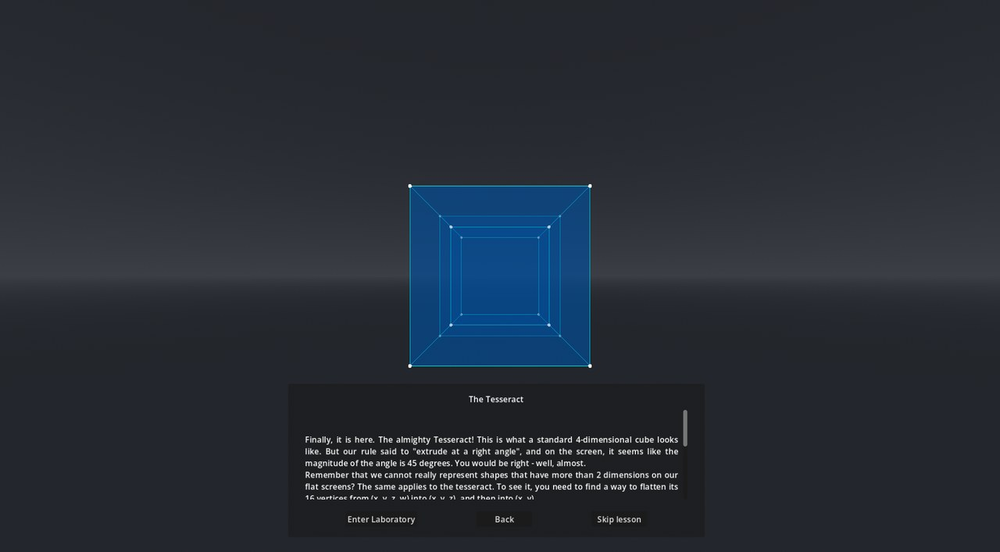
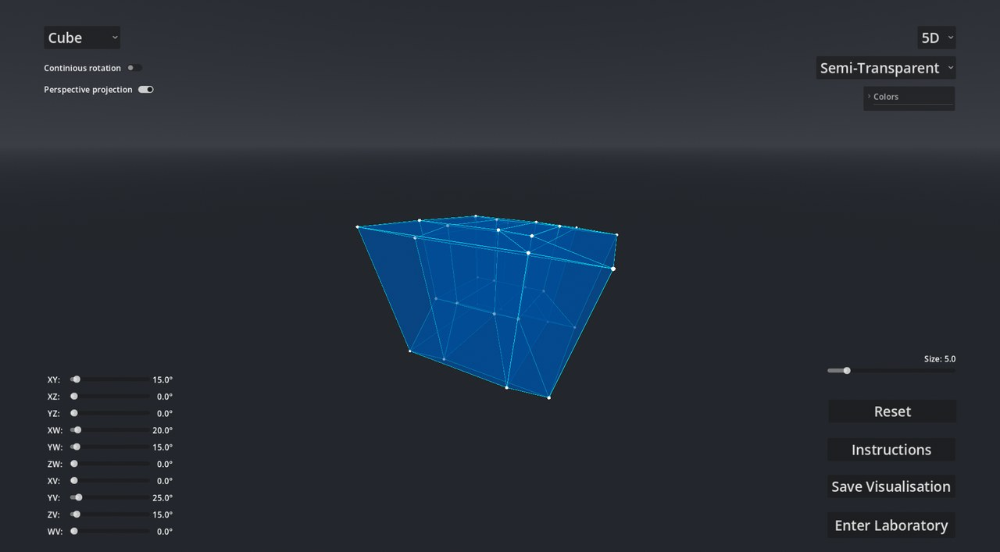
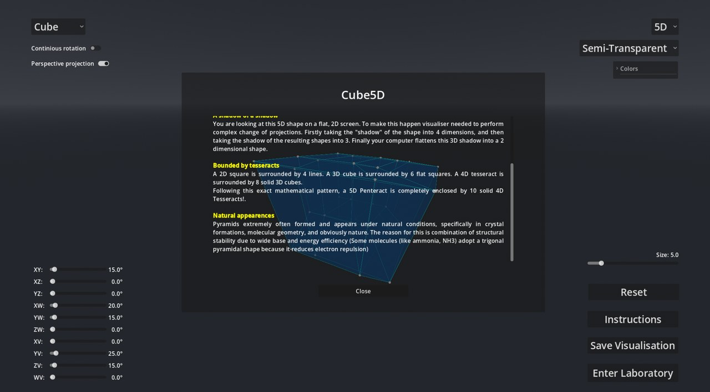
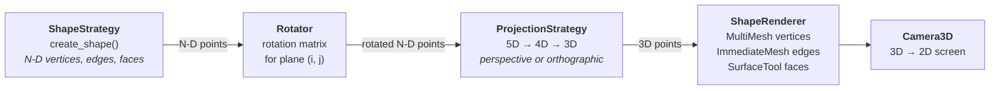
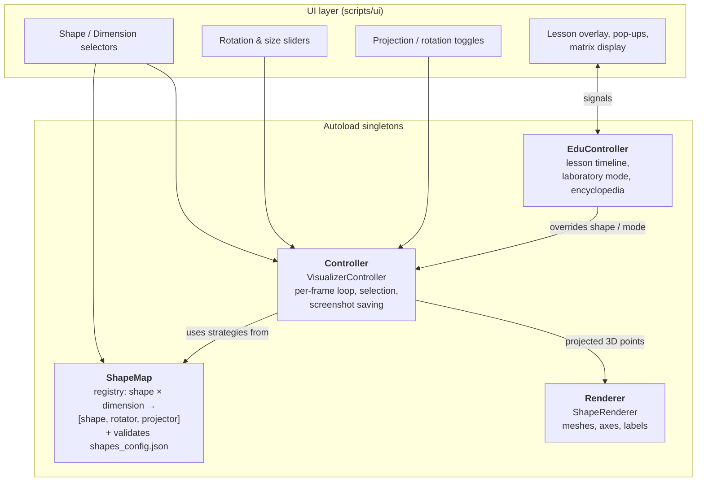
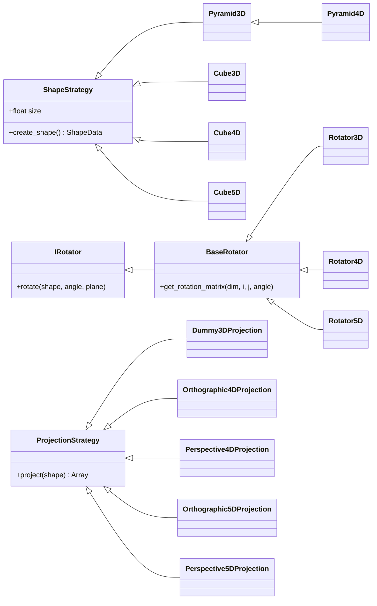
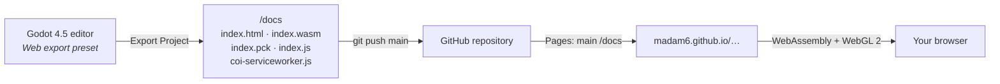

<div align="center">


# Sandbox Visualizer for Higher-Dimensional Shapes

**Rotate, project and explore 3D, 4D and 5D shapes, right in your browser.**

[](https://madam6.github.io/Sandbox-Visualizer-for-Higher-Dimensional-Shapes/)

[](https://godotengine.org/download/archive/4.5-stable/)

-orange)
[](https://madam6.github.io/Sandbox-Visualizer-for-Higher-Dimensional-Shapes/)


<sub>A tesseract (4D cube) rotating in the <b>XW</b> plane under perspective projection. The inner cube turns into the outer one.</sub>

</div>

---

## ▶ Try it now (no install needed)

The app is **hosted on GitHub Pages** and runs directly in the browser:

### 👉 **https://madam6.github.io/Sandbox-Visualizer-for-Higher-Dimensional-Shapes/**

- Nothing to download or install. Open the link and press **Okay**.
- Use an up-to-date desktop browser with **WebGL 2** (e.g. Chrome, Edge, Firefox).
- Best with a **mouse and a desktop/laptop screen**. The UI targets 1920×1080 and scales to fit.
- The first load takes a few seconds while the engine downloads (up to ~50 MB). After that the browser caches it.

You only need the sections further down if you want to open the source in Godot or rebuild the web version.

---

## Contents

- [What it does](#what-it-does)
- [Screenshots](#screenshots)
- [Controls](#controls)
- [How it works](#how-it-works)
- [Architecture](#architecture)
- [How the live version is hosted](#how-the-live-version-is-hosted)
- [Running the project locally](#running-the-project-locally)
- [Rebuilding the web version](#rebuilding-the-web-version)
- [Adding a new shape](#adding-a-new-shape)
- [Project structure](#project-structure)

---

## What it does

It's an interactive sandbox for building intuition about geometry beyond three dimensions. You pick a shape and a dimension, rotate it in any plane, and watch how its projection into our 3D world (and then onto your 2D screen) changes.

| Shape | 3D | 4D | 5D |
|---|---|---|---|
| **Cube** | Cube: 8 vertices · 12 edges | Tesseract: 16 vertices · 32 edges | Penteract: 32 vertices · 80 edges |
| **Pyramid** | Square pyramid: 5 vertices · 8 edges | 4D pyramid (5-cell): 5 vertices · 10 edges | n/a |

**Sandbox**
- 🔄 **Rotate in every plane**: 3 planes in 3D (XY, XZ, YZ), 6 in 4D (adds XW, YW, ZW), 10 in 5D (adds XV, YV, ZV, WV). Set a fixed angle, or switch on **continuous rotation** and set a speed per plane.
- 🔭 **Perspective ↔ orthographic projection** for 4D and 5D shapes.
- 🎨 **Display modes** (semi-transparent, wireframe, opaque) and a **colour picker** for vertices, edges and faces.
- 🖱️ **Vertex selection**: click a vertex to highlight it together with every edge connected to it.
- 📏 **Size slider**, **reset**, and an orbit camera with zoom.
- 💾 **Save visualisation** as a PNG. You choose whether the UI, rotation matrix and axes appear in the image.

**Learning**
- 🎓 **Guided lesson**: an animated walk from a *point → line → square → cube → tesseract*. Each step "extrudes" the previous shape into the next dimension.
- 🧪 **Laboratory mode**: shows the projected **X Y Z W V axes**, highlights the **active rotation plane**, and displays the **live rotation matrix**.
- 📖 **Encyclopedia pop-ups** (`[?]` buttons) explaining rotation matrices, projection, rotation planes and facts about each shape.

---

## Screenshots

<table>
  <tr>
    <td width="50%"></td>
    <td width="50%"></td>
  </tr>
  <tr>
    <td align="center"><b>Sandbox</b>: a tesseract rotated in the XY, XW and YW planes with perspective projection</td>
    <td align="center"><b>Laboratory</b>: projected X/Y/Z/W axes, the active plane in grey, and the live XW rotation matrix</td>
  </tr>
  <tr>
    <td width="50%"></td>
    <td width="50%"></td>
  </tr>
  <tr>
    <td align="center"><b>Guided lesson</b>: the final step, where a cube is extruded into a tesseract</td>
    <td align="center"><b>5D</b>: a penteract rotated in the XV, YV and ZV planes, projected 5D → 4D → 3D</td>
  </tr>
  <tr>
    <td colspan="2"></td>
  </tr>
  <tr>
    <td colspan="2" align="center"><b>Encyclopedia</b>: every <code>[?]</code> button opens an explanation of the maths behind what you see</td>
  </tr>
</table>

---

## Controls

| Action | How |
|---|---|
| Orbit the camera | Left-click and drag on empty space |
| Zoom | Mouse wheel |
| Choose shape / dimension | Drop-downs in the top-left / top-right |
| Rotate in a plane | Rotation sliders in the bottom-left (degrees, or speed when *Continuous rotation* is on) |
| Toggle perspective / orthographic | *Perspective projection* switch (4D and 5D only) |
| Highlight a vertex and its edges | Left-click next to the vertex |
| Change colours / display mode | *Colors* tree and the display-mode drop-down (top-right) |
| Save an image | **Save Visualisation** |
| Lesson & Laboratory | **Enter Laboratory**. The first time, a short guided lesson runs; after that the button goes straight to the lab |
| In-app help | **Instructions** button and the `[?]` buttons |

---

## How it works

All maths in the visualiser is written by hand. Godot's 3D transforms only handle three dimensions, so every frame the app runs its own N-dimensional pipeline:



**1. Rotation happens in a plane, not around an axis.** To rotate by θ in the plane formed by axes *i* and *j*, the visualiser builds an N×N identity matrix and writes cos θ and sin θ into rows/columns *i* and *j*:

$$
R_{ij}(\theta) =
\begin{pmatrix}
1 & & & & \\
& \cos\theta & \cdots & -\sin\theta & \\
& \vdots & \ddots & \vdots & \\
& \sin\theta & \cdots & \cos\theta & \\
& & & & 1
\end{pmatrix}
\qquad
\mathbf{p}' = R_{ij}(\theta)\,\mathbf{p}
$$

The same function produces 3×3, 4×4 and 5×5 matrices. All other axes stay fixed, which is why a WV rotation can look "invisible" under orthographic projection.

**2. Projection drops one dimension at a time.**

- *Orthographic*: simply discard the extra coordinates, so (x, y, z, w) becomes (x, y, z).
- *Perspective 4D → 3D*: scale by how far the point is along W from a 4D "camera" at distance $d_w$. Here $s$ is a field-of-view scale, and both values are tuned to the shape size:

$$
(x, y, z, w) \mapsto \frac{s}{d_w - w}\,(x, y, z)
$$

- *Perspective 5D → 3D*: apply the same idea twice. First divide by $(d_v - v)$ to reach 4D, then use the 4D rule above.

**3. Rendering.** The resulting 3D points go to `ShapeRenderer`, which draws vertices as instanced spheres, edges as lines, and faces as triangle fans (good for squares and triangles). Vertex picking also works without physics: each projected vertex is converted to screen space with `Camera3D.unproject_position()` and compared with the mouse position.

---

## Architecture

The app is built around four **autoload singletons** and the **Strategy pattern**, so each shape, rotator and projection can be swapped independently.





---

## How the live version is hosted

The web build is committed to the [`/docs`](docs) folder, and **GitHub Pages serves `/docs` from the `main` branch**. Pushing a new export to `main` updates the live site.



GitHub Pages can't set custom HTTP headers, so `coi-serviceworker.js` (injected through the export preset's *Head Include*) adds the cross-origin isolation headers the Godot web runtime expects.

---

## Running the project locally

> You don't need this to *use* the app. The [live version](https://madam6.github.io/Sandbox-Visualizer-for-Higher-Dimensional-Shapes/) is enough. These steps are for reading or modifying the source.

1. Clone or download this repository.
   ```bash
   git clone https://github.com/madam6/Sandbox-Visualizer-for-Higher-Dimensional-Shapes.git
   ```
2. Install **[Godot 4.5](https://godotengine.org/download/archive/4.5-stable/)** (standard version, not .NET).
3. Open Godot's Project Manager → **Import** → select `project.godot` in the cloned folder.
4. Press **F5** (or the ▶ button, top-right) to run.

**Math tests:** open `scenes/tests/testbed.tscn` and press **F6**. The results of the matrix, vector and 3D/4D/5D rotation tests print to the Output panel.

---

## Rebuilding the web version

A working build already lives in `/docs`. To regenerate it after changing the project:

1. In the editor: **Project → Export…**
2. Select the **Web (Runnable)** preset.
3. Click **Export Project…**, choose the `/docs` folder, and name the file **`index.html`**.
4. Untick **Export With Debug**, press **Save**, and confirm overwriting.
5. Commit and push `/docs` to `main`. GitHub Pages redeploys automatically.

**Testing the build locally** (needs [Python](https://www.python.org/downloads/)):

```bash
cd docs
python -m http.server 8000
```

Then open <http://localhost:8000/>. Opening `index.html` directly from disk won't work, because browsers only load WebAssembly over HTTP.

---

## Adding a new shape

The architecture is designed so a new shape needs no changes to the rendering or rotation code:

1. **Geometry**: create `scripts/math/shapes/MyShapeND.gd` that `extends ShapeStrategy` and returns a `ShapeData` (vertices as `Vector3` / `Vector4` / 5-element arrays, edges as `Vector2i`, faces as index arrays) from `create_shape()`.
2. **Register it** in `ShapeMap.shape_map` (`scripts/core/ShapeMap.gd`) with the matching rotator and projector for that dimension.
3. **Config**: add the same shape/dimension keys to `configs/shapes_config.json`. At startup `ShapeMap.validate_schema()` checks that the config and the registry match, and reports any mismatch.
4. **UI**: add the shape name to the `ShapeSelector` drop-down in `scenes/main/Main.tscn`.
5. *(Optional)* Add an encyclopedia entry keyed `"MyShapeND"` in `EducationalContoller.gd` so its `[?]` button has content.

---

## Project structure

```
├── assets/            Images used in the app (instruction screenshots, logo)
├── configs/           shapes_config.json, which defines the available shapes per dimension
├── docs/              Exported web build, served by GitHub Pages
├── scenes/
│   ├── main/          Main scene and pop-ups (welcome, instructions, info, download)
│   └── tests/         testbed.tscn, which runs the math tests
├── scripts/
│   ├── controls/      Orbit camera
│   ├── core/          Autoloads: ShapeMap, VisualizerController, EducationalController, Enums
│   ├── math/          Matrix/vector helpers, shapes, rotators, projections, tests
│   ├── rendering/     ShapeRenderer
│   └── ui/            Buttons, selectors, sliders, toggles, overlays, pop-ups
├── themes/            Godot UI themes
├── .github/readme/    Images used by this README
├── export_presets.cfg Web export preset (outputs to docs/index.html)
└── project.godot      Godot project file. Open this in Godot
```

---

<div align="center">

Built with [Godot Engine](https://godotengine.org) by **Artem Korniienko** as a third-year individual project.

**[▶ Open the live visualiser](https://madam6.github.io/Sandbox-Visualizer-for-Higher-Dimensional-Shapes/)**

</div>
