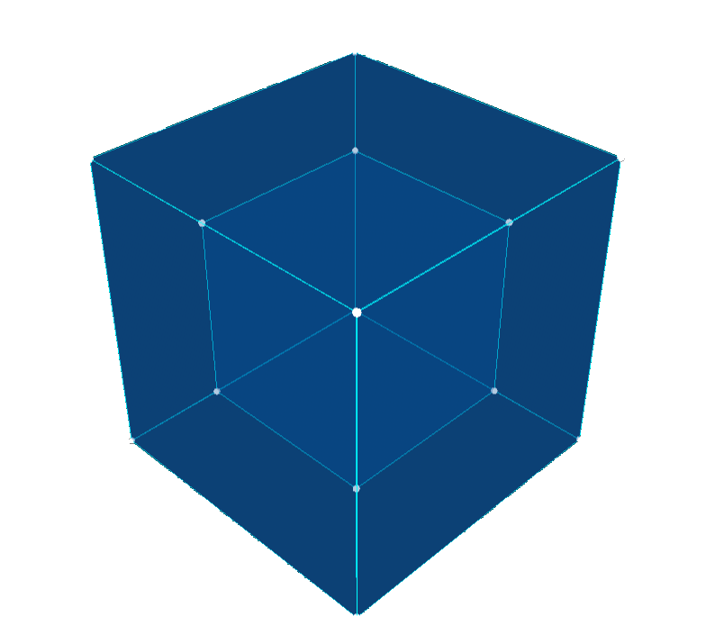
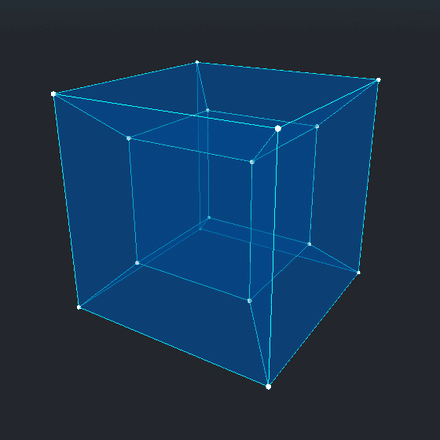
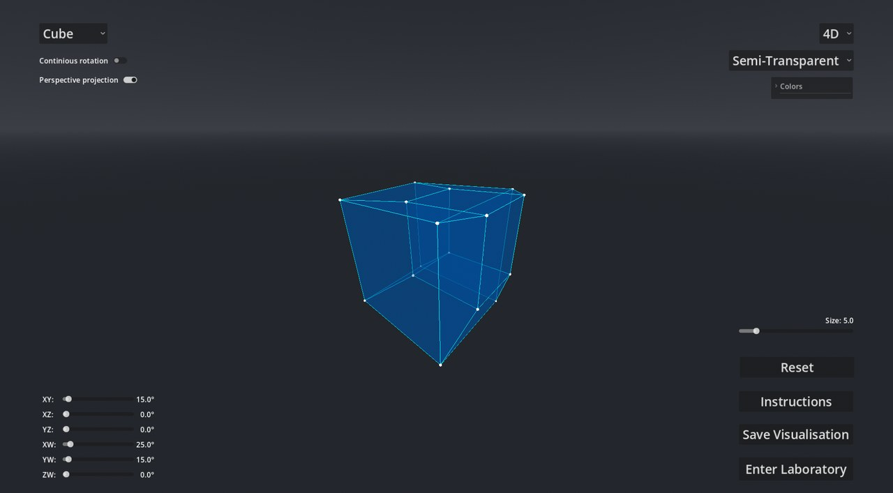
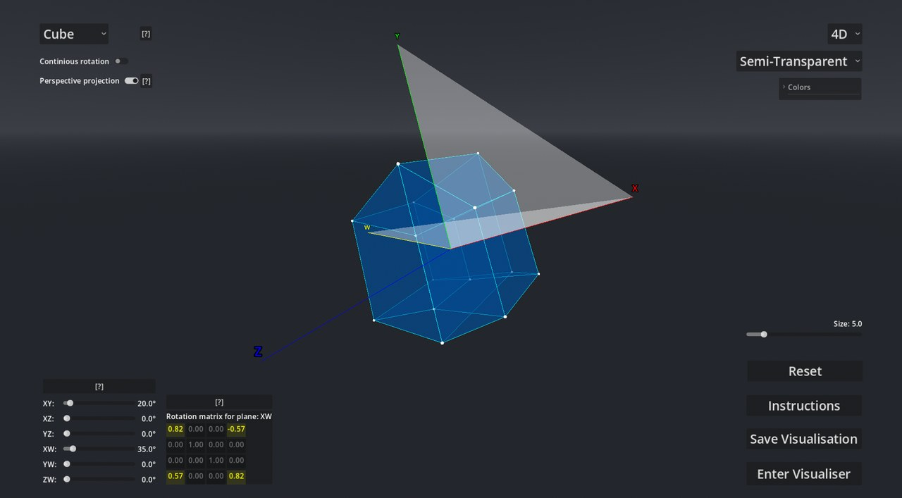
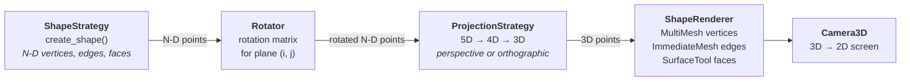
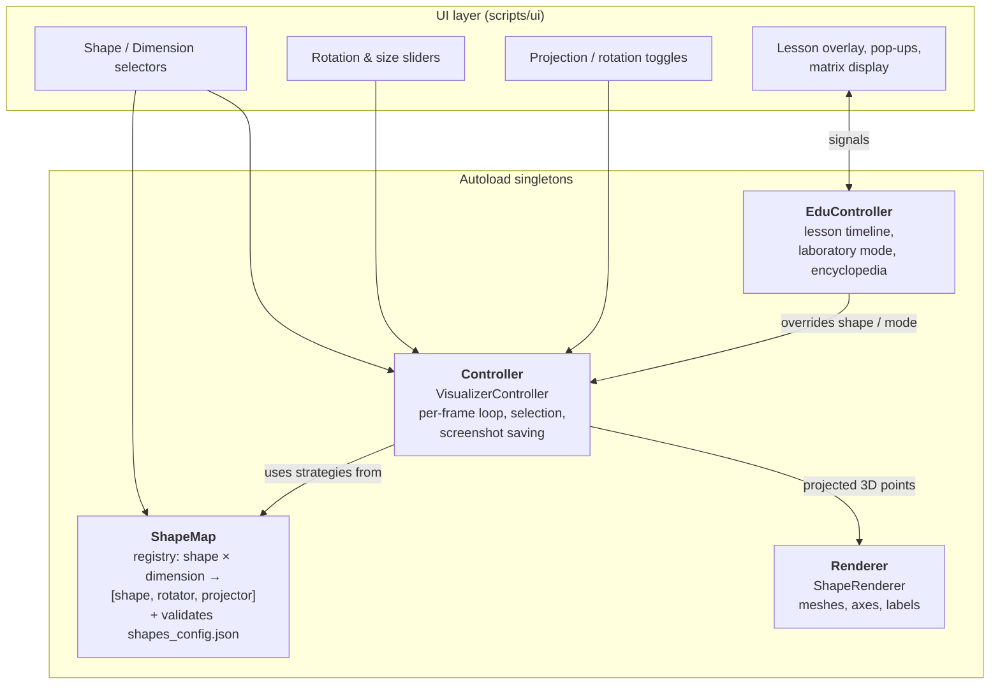
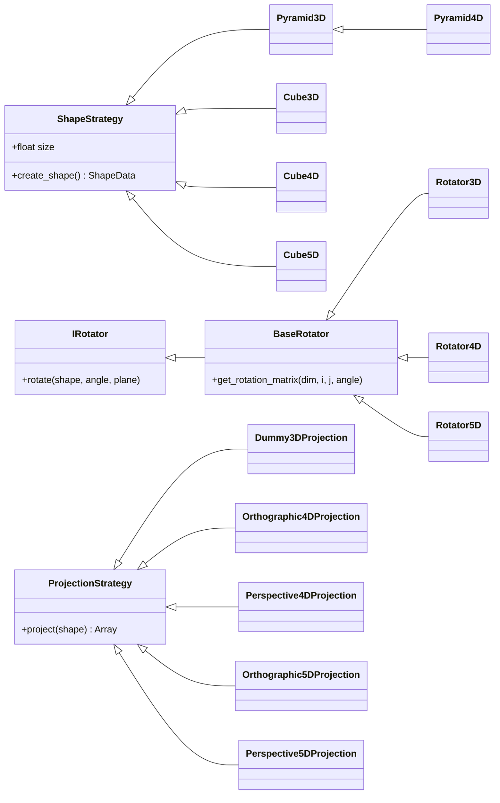
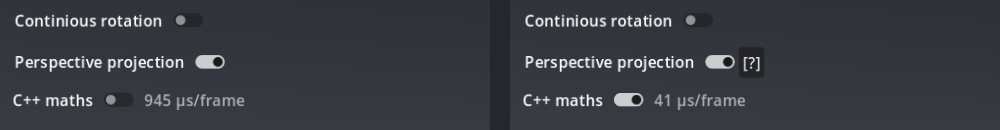
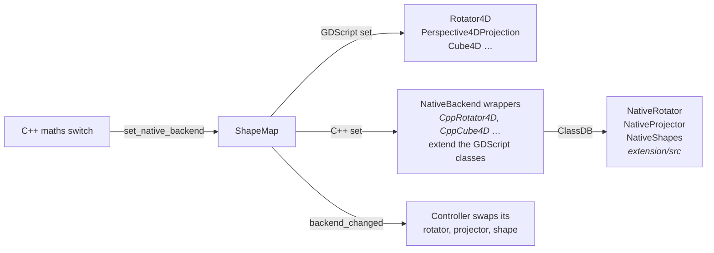
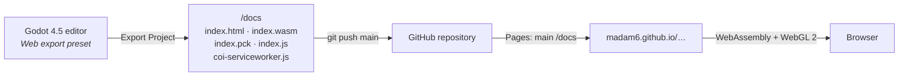

<p align="center">
  
</p>

# Sandbox Visualizer for Higher-Dimensional Shapes

A Godot 4.5 app for rotating cubes and pyramids in 3D, 4D and 5D and watching what their projections do. It's my third-year individual project.

You pick a shape and a dimension, then turn it in any of its rotation planes, including the ones that involve the fourth (W) and fifth (V) axes. A short guided lesson and a "laboratory" mode explain the maths behind what's on screen.

The web build runs on GitHub Pages at <https://madam6.github.io/Sandbox-Visualizer-for-Higher-Dimensional-Shapes/>.

<p align="center">
  
  <br>
  <sub>A tesseract turning in the XW plane under perspective projection. The inner and outer cubes trade places every 90°.</sub>
</p>

## Contents

- [What it does](#what-it-does)
- [Screenshots](#screenshots)
- [Controls](#controls)
- [How it works](#how-it-works)
- [Architecture](#architecture)
- [C++ version (GDExtension)](#c-version-gdextension)
- [How the web version is hosted](#how-the-web-version-is-hosted)
- [Running it locally](#running-it-locally)
- [Rebuilding the web version](#rebuilding-the-web-version)
- [Adding a new shape](#adding-a-new-shape)
- [Project structure](#project-structure)
- [Limitations](#limitations)

## What it does

| Shape | 3D | 4D | 5D |
|---|---|---|---|
| Cube | cube, 8 vertices, 12 edges | tesseract, 16 vertices, 32 edges | penteract, 32 vertices, 80 edges |
| Pyramid | square pyramid, 5 vertices, 8 edges | 5-cell, 5 vertices, 10 edges | not available |

Each extra dimension adds rotation planes. A 3D shape has three (XY, XZ, YZ), a 4D shape has six, and a 5D shape has ten. Every plane gets its own slider. With continuous rotation switched on, the sliders set a speed instead of an angle.

4D and 5D shapes can be drawn with perspective or orthographic projection. The difference is easiest to see on an unrotated tesseract: in perspective the far cube looks smaller and sits inside the near one, while orthographic projection lays both cubes on top of each other.

Clicking a vertex highlights it along with every edge attached to it. The display can be semi-transparent, wireframe or opaque, and vertex, edge and face colours are adjustable. "Save Visualisation" writes a PNG, with checkboxes for what to include in it.

The first time you press "Enter Laboratory", a five-step lesson runs. It extrudes a point into a line, the line into a square, then a cube, then a tesseract, and animates each extrusion. After that the button takes you straight to the laboratory, which adds:

- the X, Y, Z, W and V axes, projected along with the shape
- a grey triangle marking each plane that is currently rotating
- the live rotation matrix for the last plane you moved
- `[?]` buttons that open short explanations of rotation matrices, projection and rotation planes, and facts about the current shape

## Screenshots

<table>
  <tr>
    <td width="50%"></td>
    <td width="50%"></td>
  </tr>
  <tr>
    <td align="center">Tesseract rotated in XY, XW and YW, perspective projection</td>
    <td align="center">Laboratory: projected axes, the XW plane shaded, its rotation matrix bottom left</td>
  </tr>
  <tr>
    <td width="50%"></td>
    <td width="50%"></td>
  </tr>
  <tr>
    <td align="center">Last lesson step, where the cube becomes a tesseract</td>
    <td align="center">Penteract (5D cube), projected 5D → 4D → 3D</td>
  </tr>
  <tr>
    <td colspan="2"></td>
  </tr>
  <tr>
    <td colspan="2" align="center">The <code>[?]</code> pop-up for the penteract</td>
  </tr>
</table>

## Controls

| Action | How |
|---|---|
| Orbit the camera | Left-drag on empty space |
| Zoom | Mouse wheel |
| Shape and dimension | Drop-downs, top left and top right |
| Rotate | Sliders, bottom left |
| Perspective or orthographic | "Perspective projection" switch (4D and 5D only) |
| Highlight a vertex | Left-click next to it |
| Colours and display mode | "Colors" tree and the drop-down under the dimension selector |
| Save an image | "Save Visualisation" |
| Lesson and laboratory | "Enter Laboratory" |
| Help | "Instructions" and the `[?]` buttons |

## How it works

Godot's transforms stop at three dimensions, so the app keeps its own vertex arrays and runs this every frame:



A rotation happens in the plane spanned by two axes, i and j. The rotator starts from an N×N identity matrix and writes cos θ and sin θ into rows and columns i and j:

$$
R_{ij}(\theta) =
\begin{pmatrix}
1 & & & & \\
& \cos\theta & \cdots & -\sin\theta & \\
& \vdots & \ddots & \vdots & \\
& \sin\theta & \cdots & \cos\theta & \\
& & & & 1
\end{pmatrix}
\qquad
\mathbf{p}' = R_{ij}(\theta)\,\mathbf{p}
$$

Every other coordinate stays where it was. That's why a WV rotation of a 5D shape changes nothing on screen under orthographic projection: W and V are the two coordinates that projection throws away.

Orthographic projection drops the extra coordinates, so (x, y, z, w) becomes (x, y, z). Perspective projection divides by the distance to a camera placed out along the extra axis:

$$
(x, y, z, w) \mapsto \frac{s}{d_w - w}\,(x, y, z)
$$

Here $s$ is a field-of-view scale and $d_w$ the camera distance, both derived from the shape size. In 5D the step runs twice, first along V (dividing by $d_v - v$) and then along W.

`ShapeRenderer` draws the result: vertices as instanced spheres, edges as lines, and faces as triangle fans. Picking a vertex doesn't go through physics. Each projected vertex is converted to screen space with `Camera3D.unproject_position()`, and any vertex within 30 px of the click is toggled.

## Architecture

Four autoload singletons hold the state. Shapes, rotators and projections are interchangeable strategy objects, so the controller doesn't care which ones it has.





## C++ version (GDExtension)

The rotation, projection and shape-building code also exists in C++, as a GDExtension in [`extension/`](extension). Both versions sit in the same project. The "C++ maths" switch under the projection toggle swaps between them while the app is running and shows how long rotation plus projection took per frame:

<p align="center">
  
  <br>
  <sub>Same tesseract, GDScript on the left and C++ on the right. Debug build, i7-12700H.</sub>
</p>



Each wrapper in `scripts/native/NativeBackend.gd` extends the matching GDScript class and overrides only the maths method. Properties like `size` and `w_distance` are inherited, so the rest of the code can't tell the two apart. When the switch flips, `ShapeMap` swaps its whole strategy set, and the controller swaps the three objects it's holding for their counterparts. The vertices keep their current rotation, because both versions store points the same way.

The wrappers create the C++ objects through `ClassDB` by name and never reference the C++ classes directly. When the library isn't loaded the GDScript still parses, the switch hides itself, and the app runs as it did before the extension existed. The web build depends on this: the Web export preset excludes `bin/`, so the hosted version is GDScript only.

### Building it

You need Python with SCons and a C++ compiler. It has been tested with Visual Studio 2026 (MSVC) and Godot 4.5 on Windows.

```bash
git submodule update --init          # fetches godot-cpp (branch 4.5) into extension/godot-cpp
cd extension
scons platform=windows target=template_debug     # used by the editor
scons platform=windows target=template_release   # used by release exports
```

The DLLs land in `bin/`, where `bin/native_math.gdextension` points Godot at them. The first build takes a few minutes because it compiles godot-cpp too. If the library is missing, Godot prints three "GDExtension dynamic library not found" errors at startup and carries on in GDScript.

### Benchmark

`scenes/tests/benchmark.tscn` first checks that both versions give the same vertices, edges, faces, rotations and projections (within 1e-4), then times them. Open the scene and press F6, or run:

```bash
godot --headless --path . res://scenes/tests/benchmark.tscn
```

One run on an i7-12700H, Godot 4.5, debug build. Times are microseconds per call. A "frame" means rotating in every plane and then projecting, which is what the controller does each frame.

| Shape | Operation | GDScript | C++ | Speed-up |
|---|---|--:|--:|--:|
| Cube 3D | create_shape | 8.6 | 15.2 | 0.6× |
| Cube 3D | frame, 3 planes | 236 | 4.9 | 48× |
| Pyramid 3D | create_shape | 7.2 | 13.7 | 0.5× |
| Pyramid 3D | frame, 3 planes | 162 | 7.8 | 21× |
| Cube 4D | create_shape | 46.9 | 28.1 | 1.7× |
| Cube 4D | frame, 6 planes | 1185 | 11.1 | 107× |
| Pyramid 4D | create_shape | 15.1 | 13.6 | 1.1× |
| Pyramid 4D | frame, 6 planes | 406 | 9.9 | 41× |
| Cube 5D | create_shape | 1557 | 90.5 | 17× |
| Cube 5D | frame, 10 planes | 4954 | 231 | 21× |
| 5000 random 4D points | rotate + project | 65,995 | 369 | 179× |

Absolute times vary between runs, by up to 40% on this laptop. The ratios stay close.

Some of these numbers need context:

- Part of the rotation gap comes from the algorithm. `BaseRotator` builds a fresh rotation matrix for every vertex and multiplies the full N×N matrix. The C++ version only updates the two coordinates in the rotation plane, since the rest of the matrix is the identity. The results match to float precision.
- Small shapes are slower to build in C++. Packing the result into a Dictionary and converting it to typed arrays on the GDScript side costs more than GDScript spends writing out eight vertices.
- The penteract gains less per frame (21×) than the tesseract (107×). Its points are Arrays rather than Vector4s, so the C++ code allocates a new Array for every point in every plane.
- In 3D and 4D the switch makes no visible difference: about 1 ms of a 16.7 ms frame at 60 fps. In 5D the GDScript path takes about 5 ms per frame, which starts to matter on a slower machine or in the browser.

## How the web version is hosted

The exported web build is committed to [`/docs`](docs), and GitHub Pages serves that folder from `main`. Pushing a new export updates the site.



GitHub Pages can't set custom HTTP headers, so `coi-serviceworker.js`, added through the export preset's head include, supplies the cross-origin isolation headers the Godot web runtime asks for.

## Running it locally

1. Clone the repository:
   ```bash
   git clone https://github.com/madam6/Sandbox-Visualizer-for-Higher-Dimensional-Shapes.git
   ```
2. Install [Godot 4.5](https://godotengine.org/download/archive/4.5-stable/), the standard build (not .NET).
3. In the Project Manager, choose Import and select `project.godot`.
4. Press F5.

The C++ part is optional; see [Building it](#building-it). For the maths unit tests, open `scenes/tests/testbed.tscn` and press F6. Results print to the Output panel.

## Rebuilding the web version

1. Project → Export…, then pick the Web preset.
2. Export Project…, choose the `docs` folder, and name the file `index.html`.
3. Untick "Export With Debug", save, and confirm the overwrite.
4. Commit `docs` and push to `main`.

The preset's exclude filter is `bin/*`. Keep it unless you've built the extension for the web as well. Without it the export fails looking for a `.wasm` version of the library.

To try the build locally you need an HTTP server, because browsers won't load WebAssembly from `file://`:

```bash
cd docs
python -m http.server 8000
```

Then open <http://localhost:8000/>.

## Adding a new shape

1. Write `scripts/math/shapes/MyShapeND.gd` extending `ShapeStrategy`. Its `create_shape()` returns a `ShapeData`: vertices as `Vector3`, `Vector4` or 5-element arrays, edges as `Vector2i`, and faces as lists of vertex indices.
2. Add an instance to `ShapeMap.build_gdscript_set()` and an entry in the `shape_map` built by `ShapeMap._apply_set()`, next to the rotator and projector for its dimension.
3. Add the same shape and dimension keys to `configs/shapes_config.json`. On startup `ShapeMap.validate_schema()` compares the two and reports any mismatch.
4. Add the name to the `ShapeSelector` drop-down in `scenes/main/Main.tscn`.
5. Optionally, add an encyclopedia entry keyed `"MyShapeND"` in `EducationalContoller.gd` for its `[?]` button.

A C++ version is optional. Without one the shape keeps using GDScript when the switch is on. To add one, write a method on `NativeShapes` in `extension/src/native_shapes.cpp`, a wrapper class in `NativeBackend.gd`, and an entry in `NativeBackend.build_strategy_set()` under the same key.

## Project structure

```
├── assets/            Images used inside the app (instruction screenshots, logo)
├── bin/               native_math.gdextension and the compiled C++ library
├── configs/           shapes_config.json, the list of shapes per dimension
├── docs/              Exported web build, served by GitHub Pages
├── extension/         C++ source (src/), SConstruct, godot-cpp submodule
├── scenes/
│   ├── main/          Main scene and pop-ups
│   └── tests/         testbed.tscn (maths tests), benchmark.tscn (GDScript vs C++)
├── scripts/
│   ├── controls/      Orbit camera
│   ├── core/          Autoloads: ShapeMap, VisualizerController, EducationalController, Enums
│   ├── math/          Matrix and vector helpers, shapes, rotators, projections, tests
│   ├── native/        NativeBackend.gd, the GDScript wrappers around the C++ classes
│   ├── rendering/     ShapeRenderer
│   └── ui/            Buttons, selectors, sliders, toggles, overlays, pop-ups
├── themes/            Godot UI themes
├── .github/readme/    Images used in this README
├── export_presets.cfg Web export preset (writes docs/index.html)
└── project.godot      Open this in Godot
```

## Limitations

- There are two shape families: cubes from 3D to 5D and pyramids in 3D and 4D.
- The controls assume a mouse, since orbiting is a drag and zoom is the scroll wheel.
- The lesson runs once per session. Nothing is saved between visits.
- The C++ library has only been built and tested on Windows. `native_math.gdextension` lists Linux and web paths, but those libraries haven't been built yet, and the hosted web version doesn't include the extension.

---

Artem Korniienko, 2025–2026. Built with [Godot](https://godotengine.org).
